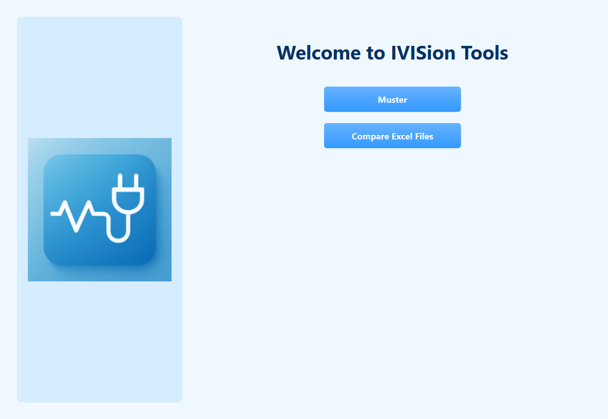
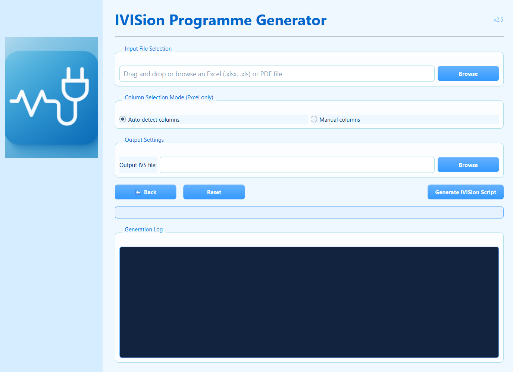
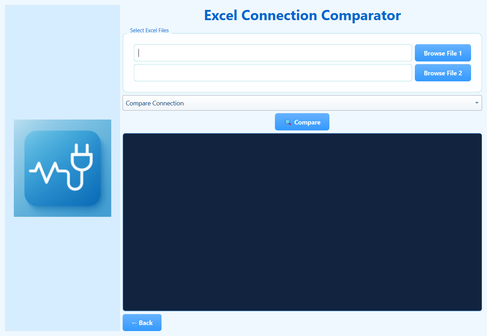

# IVISion Test Script Generator

A desktop application (Python and PyQt6) that automatically turns cable harness wiring lists into ready to run test programs for **IVISion** cable testers. It reads a wiring list from **Excel** or **PDF**, rebuilds the electrical connections, groups splice points into networks, and writes the test script in **IVISion Studio** or **IVISion 3** format. A second tool compares two versions of a wiring list or a material list and shows exactly what changed.

Writing these test programs by hand takes hours and is error prone. This tool generates them in seconds.



## Table of contents

1. [Features](#features)
2. [How it works](#how-it-works)
3. [Supported input formats](#supported-input-formats)
4. [Example](#example)
5. [Screenshots](#screenshots)
6. [Technologies](#technologies)
7. [Project structure](#project-structure)
8. [Quick start](#quick-start)

For a full step by step guide, read [TUTORIAL.md](TUTORIAL.md).

## Features

**Script generator**

1. Input from Excel (`.xlsx`, `.xls`) or PDF wiring diagrams, by drag and drop or file browser
2. Automatic detection of the column layout of the wiring list, or manual choice of 2 or 4 columns
3. Cleaning of device and pin addresses written in many different styles (`X1:2`, `X1/2:3`, `=+A-X1:2` ...)
4. Detection of splice points (SP) and grouping of connected splices into a single star network
5. Detection of resistors with a reminder in the script
6. PDF support with text extraction, and OCR (Tesseract) for scanned pages
7. Output in **IVISion Studio** format (`TestNetwork`, `TestConnection`, isolation and unplug tests) or **IVISion 3** format (`CONNECTION`)
8. Progress bar and colored generation log

**Comparison tool**

1. **Compare Connection:** finds the connections added and removed between two wiring list versions
2. **Compare Material:** finds the parts added, removed or changed (quantity or reference) between two material lists

## How it works

| Step | What happens |
|:---:|---|
| 1 | The wiring list is loaded with pandas (Excel) or pdfplumber and PyMuPDF (PDF, with OCR fallback) |
| 2 | The column format is detected and every row becomes a connection between two points `device/pin` |
| 3 | Addresses are normalised to the `DEVICE/PIN` style expected by the tester |
| 4 | Splice points are found and connected splices are merged with a graph search (BFS) into one network |
| 5 | Each network becomes a `TestNetwork` with a star topology, every other wire becomes a `TestConnection` |
| 6 | Resistors are detected and the standard end of program is added (isolation test, unplug test, operator and order number prompts) |
| 7 | For IVISion 3, the script is converted to `CONNECTION` statements |

## Supported input formats

The column layout is detected automatically. Header names are not case sensitive.

| Type | Recognised columns |
|---|---|
| 4 columns | `from Device`, `from Pin`, `to Device`, `to Pin` |
| 4 columns | `from Device Name`, `from Pin`, `to Device Name`, `to Pin` |
| 4 columns (German) | `von Art/Zählnr.`, `von Anschlusspunkt`, `nach Art/Zählnr.`, `nach Anschlusspunkt` |
| 2 columns | `start`, `end` / `from`, `to` / `von`, `nach` / `von Betriebsmittelk`, `nach Betriebsmittelk` |
| Other layouts | Several other wiring list exports are recognised from their content (cells such as `X1:2` or `X1/2`) |
| Manual | You type the names of 2 or 4 columns yourself |

## Example

Input wiring list (first rows of [samples/sample_wiring_list.xlsx](samples/sample_wiring_list.xlsx), invented data):

| from Device | from Pin | to Device | to Pin |
|---|---|---|---|
| X1 | 1 | SP1 | 1 |
| X2 | 3 | SP1 | 1 |
| K1 | A1 | SP1 | 1 |
| X1 | 2 | SP2 | 1 |
| X3 | 5 | SP2 | 1 |
| SP2 | 1 | SP3 | 1 |
| X4 | 1 | SP3 | 1 |
| X1 | 3 | X2 | 4 |
| R1 | 1 | X4 | 2 |

Generated IVISion Studio script (shortened, full file in [samples/sample_output.ivs](samples/sample_output.ivs)):

```
TestNetwork( 'SP1', Topology= STAR, "K1/A1", "X1/1", "X2/3" );
TestNetwork( 'SP2-SP3', Topology= STAR, "X1/2", "X3/5", "X4/1" );
TestConnection( "R1/1", "X4/2" );
TestConnection( "X1/3", "X2/4" );
//===> Vérifier si ( R1 ) sont des resistances

DoIsolationTest();
UIMessageStop('DEBRANCHER LE CABLAGE');
DoUnplugTest();
end.
```

`SP2` and `SP3` are connected together, so they are merged into a single network.

Same result in IVISion 3 format (shortened, full file in [samples/sample_output_ivs3.ivs](samples/sample_output_ivs3.ivs)):

```
DefSec( Section1 );
CONNECTION ( SP1; K1/A1, X1/1, X2/3 );
CONNECTION ( SP2-SP3; X1/2, X3/5, X4/1 );
CONNECTION ( R1/1, X4/2 );
CONNECTION ( X1/3, X2/4 );
```

## Screenshots

| Script generator | Comparison tool |
|:---:|:---:|
|  |  |

## Technologies

| Part | Tools |
|---|---|
| Interface | PyQt6 |
| Excel | pandas, openpyxl |
| PDF | pdfplumber, PyMuPDF, pdf2image, pytesseract (OCR) |
| Graph processing | networkx, BFS with `collections.deque` |
| Templates | Jinja2 |
| Packaging | PyInstaller (to build a Windows `.exe`) |

## Project structure

```
IVISion_Test_Script_Generator/
|  main.py                    Starts the application
|  welcome.py                 Home window (choose a tool)
|  gui.py                     Script generator window
|  ivs_generator.py           Excel parsing, address cleaning, splice grouping, IVISion Studio output
|  ivs3_generator.py          IVISion 3 output
|  pdf_generator.py           PDF text and OCR extraction, graph based generation
|  new_pdf_parser.py          Parser for table style PDF diagrams with SP labels
|  compare_gui.py             Comparison window
|  compare_logic.py           Wiring list comparison
|  compare_material_logic.py  Material list comparison
|  icon.ico, logo.png         Application images
|  requirements.txt
|__ samples/                  Invented wiring and material lists with generated outputs
|__ docs/                     Screenshots
```

## Quick start

```bash
git clone https://github.com/achrefslim/IVISion_Test_Script_Generator.git
cd IVISion_Test_Script_Generator
pip install -r requirements.txt
python main.py
```

PDF files that are scanned images also need **Tesseract OCR** and **Poppler** installed on the computer (see [TUTORIAL.md](TUTORIAL.md)).

## Note

All example files in `samples/` are invented for demonstration. No real customer wiring data is included in this repository.

## Author

[achrefslim](https://github.com/achrefslim)
